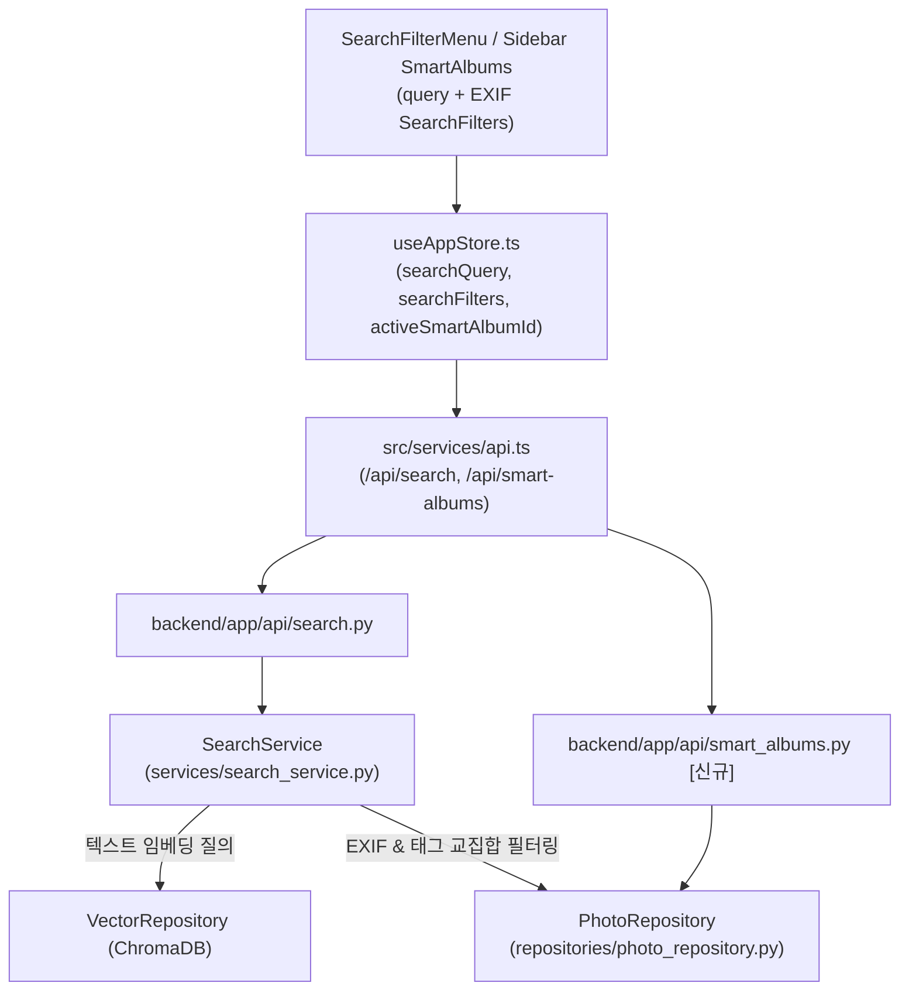

# [Architecture] 02. Hybrid Search, K-NN Curation & Smart Albums

---

## 🏛️ 1. 하이브리드 검색 및 스마트 앨범 흐름도



---

## 🏗️ 2. 도메인 파일 트리 및 단일 책임 (SRP)

```text
backend/app/
├── models.py                          # [수정대상] SmartAlbum ORM 모델 추가
├── schemas.py                         # [수정대상] SearchRequest, SearchFilter, SmartAlbumSchema
├── api/
│   ├── search.py                      # [기존] POST /api/search, POST /api/search/similar
│   └── smart_albums.py                # [신규] GET/POST/DELETE /api/smart-albums 라우터
├── services/search_service.py         # [기존] SQLite 캡션/태그 텍스트 매칭 + ChromaDB 벡터 유사도 결합 후 EXIF 교집합 필터링
└── repositories/photo_repository.py   # [수정대상] EXIF 필터 쿼리 및 SmartAlbum CRUD 메서드

src/
├── types/photo.ts                     # [수정대상] SearchFilters, SmartAlbum 타입 정의
├── services/api.ts                    # [수정대상] searchPhotos, getSmartAlbums, createSmartAlbum, deleteSmartAlbum
├── store/useAppStore.ts               # [수정대상] 검색 필터 상태 및 스마트 앨범 원클릭 적용 액션
├── hooks/useDebounce.ts               # [기존] 검색어 입력 500ms 디바운스 훅
└── components/
    ├── SearchFilterMenu.tsx           # [수정대상] 기종/렌즈/ISO/조리개/화각/날짜 필터 및 스마트 앨범 저장 트리거
    ├── Sidebar.tsx                    # [수정대상] Smart Albums 섹션 리스트 및 삭제 버튼
    └── filter/FilterRangeInput.tsx    # [기존] 최소/최대 수치 범위 입력 서브컴포넌트
```

---

## 🤝 3. 타 도메인 참조 및 경계 계약 (Cross-Domain Dependencies)

* **참조하는 외부 도메인 (Inbound/Read)**:
  - `00_core_foundation`: `ai_factory.get_siglip_adapter()`를 통해 텍스트 질의어 768차원 임베딩 추출.
  - `01_indexing_storage`: `PhotoRepository`(`search_by_text`, `get_filtered_photos`) 및 `VectorRepository`(`query_similar_by_embedding`, `get_embedding`) 참조.
* **외부 도메인에 노출하는 계약 (Outbound/Expose)**:
  - `04_studio_ui_analytics`: `useAppStore`의 `searchQuery` 및 `searchFilters` 상태를 통해 `PhotoGallery.tsx`에 검색/필터링된 사진 리스트를 공급합니다.

---

## 🔒 4. 도메인 아키텍처 제약 규칙

1. **검색 상태 일원화**: `SearchFilterMenu`와 `Sidebar`에서의 검색/필터 조작은 반드시 `useAppStore`의 `searchQuery` 및 `searchFilters` 상태를 전이시켜 갤러리 쿼리가 반응형으로 갱신되도록 합니다.
2. **하이브리드 후보 결합 순서 (`SearchService.execute_hybrid_search`)**: 질의어가 존재할 때 (1) SQLite `AIAnalysis.tags`/`caption` 키워드 매칭 ID와 (2) SigLIP 2 텍스트 임베딩 기반 ChromaDB 유사 ID를 순서대로 병합한 뒤, (3) `PhotoRepository.get_filtered_photos()`에서 EXIF 조건 교집합을 적용하고 병합 순서를 보존하여 반환합니다.
